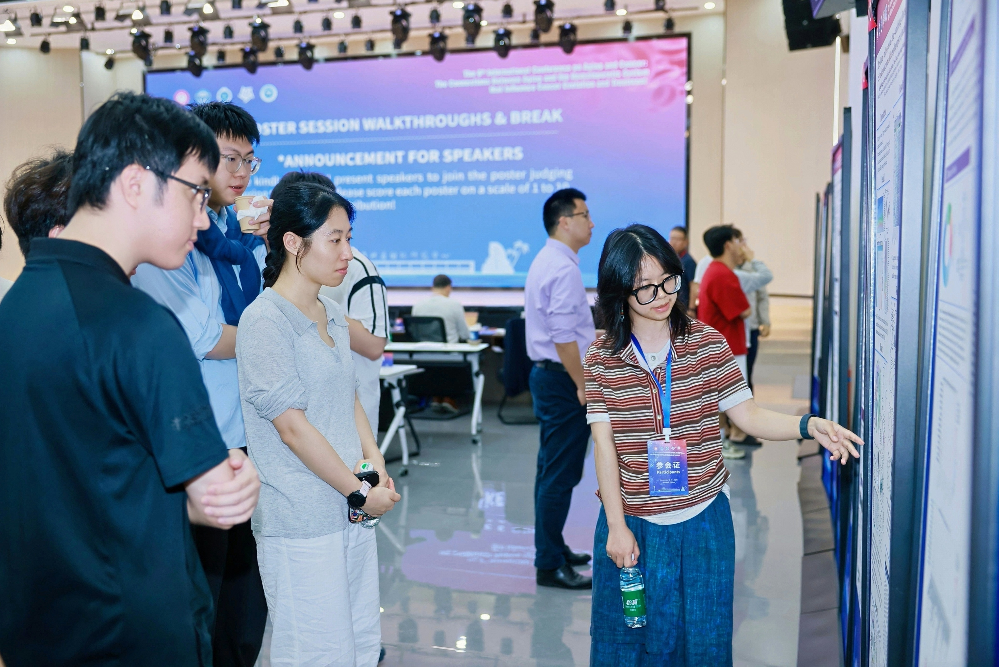
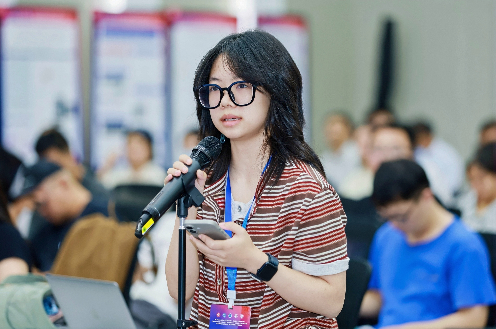
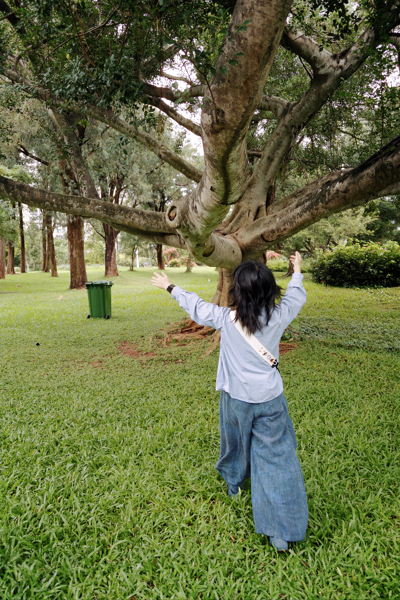

## Seminar information

- Location: Haikou, China

- Time duration: 06 Nov 2026 - 08 Nov 2026

- Website: [8th ICAC](https://www.icacconference.cn/)

## Thoughts

[Notes link (in personal Notion - private)](https://app.notion.com/p/International-centre-for-aging-and-cancer-4103baf9f88380c7ba67f62a0f3e1b18?source=copy_link)



After a six-month slump, I seem to have rediscovered my interest in keeping up with new developments in research. University seminars and the conferences open to me have started to appeal again. So, at my supervisor’s request, I went along to an international conference on ageing and cancer.

Before it began, I had assumed the programme would be split into two strands, with some talks trying to bridge the two themes and look for mechanisms they share. Once I started listening, I found that most talks took a different approach. They linked the ageing process to tumorigenesis, looking for physiological changes that build up with age and eventually promote tumour.

Overall, though, very few talks examined specific mechanisms. Most of the work resembled the research of the last century: observational and descriptive. A team would collect data from a cohort or intervene in an animal model, then report that older humans or animals were more prone to tumours and survived for shorter periods. Within this theme, only a handful of speakers addressed which molecules were actually responsible, and none went into much depth. **Prof. Vera Gorbunova** began with transposable elements. She explained that they become increasingly derepressed with age, so that cDNA reverse-transcribed from LINE-1 can promote tumorigenesis by activating cGAS/STING signalling. Blocking this reverse transcription with reverse transcriptase inhibitors lowered tumour incidence. Hers was the only talk on this theme with a clearly defined mechanistic investigation.

**Prof. Ronald A. DePinho** also discussed mechanism. He described how telomerase reverse transcriptase (TERT) becomes increasingly active during ageing as H3K9me3 is lost and H3K27ac marks open up the chromatin. This epigenetic mechanism can be targeted with a TERT activator compound (TAC) to study the link between ageing and cancer. However, the focus of the work soon moved to combination therapy with anti-PD-1. I felt the mechanism had not yet been fully worked out when they rushed into translation. Still, I liked a point he made during the Q&A: rather than looking only at telomere length, we should look more closely at whether telomere function has changed. This differs somewhat from what we learn in textbooks. It is precisely because telomeres turn out not to lengthen in every ageing-associated tumour that researchers have started to examine functional changes in more detail. How to define whether a telomere is functional or dysfunctional, however, seems to need further mechanistic work that can provide comparable evidence.

**Prof. Ashani Weeraratna** found that aged fibroblasts lose their antigen-presenting capacity, which counts as a modest piece of mechanistic work, and that this makes them more susceptible to influence from melanoma cells. In the aged tumour immune microenvironment, Tregs are enriched while CD8+ T cells are depleted, which fosters an immunosuppressive environment. Young mice, by contrast, express high levels of *Wnt5a*, which holds back the metastatic tendency of melanoma cells, and so they survive longer than aged mice. This again offered a hint of mechanism, though I didn’t hear a detailed explanation of how exactly *Wnt5a* affects metastasis.

Another point I found interesting came from the opening speaker, **Prof. Peter D. Adams**. He argued that using aged mice rather than young ones as hosts for tumour transplantation would be a more realistic way to study how cancer arises and progresses. In the gastric cancer models I mainly work with at the moment, this probably isn’t necessary, as gastric cancer has a relatively weak association with age. If I move on to other cancer types in future, though, I will need to consider whether my choice of model reflects patients’ real-world circumstances. I jotted down a question at the time but couldn’t ask it because we ran out of time. Natural ageing in mice may introduce a great many variables, much as patients in clinical cohorts vary widely. Could this challenge the basic principle of controlling variables in experimental design? Would we need far larger numbers of mice, for instance, to stop this heterogeneity from masking the main effect?

Another talk with more of a genetics focus came from **Prof. Ashok Venkitaraman**, and I thought it was rather good. *BRCA2* mutations occur in many cancers, but earlier studies found that a mutation in a single allele is not enough to drive tumorigenesis, and in genome sequencing only biallelic mutations are considered relevant. He found, however, that when one allele carries a germline mutation, the second copy, although apparently functionally normal, is more likely to be epigenetically silenced in somatic cells in response to environmental factors such as aldehyde exposure, an external carcinogenic factor. The result is a pro-tumorigenic effect similar to that of a biallelic mutation. The principle is easy to grasp, but perhaps because I hadn’t encountered genomics research for a long while, or perhaps because he presented it so well, I found it fascinating.

Perhaps reflecting the networks within this field, the organisers also invited many speakers working on haematopoietic stem cell differentiation during ageing, though the link to cancer was somewhat tenuous. At first it felt fresh, as it is a field I hadn’t read about before, but by the end I was starting to tire of it. Most of the speakers’ work sounded much the same, and again there was little exploration of mechanisms or underlying principles; it was mainly descriptive. There were still ideas worth taking away. **Prof. Abel David González-Pérez**, for example, proposed that natural selection already operates in normal tissues, and that the selected clones only gradually start to promote tumorigenesis as they accumulate. This view treats cancer itself as a side effect of natural selection. So what natural advantages does this accumulation confer, such that it happens to produce a population favourable to cancer? Nobody seems to have answered this convincingly yet.

Perhaps it is because I have spent so long at a school of basic medical sciences, I have come to strongly prefer scientific stories that are told by working through a complete mechanistic chain. Yet the curiosity and thirst for knowledge that drive people to explore this territory may struggle to hold out against the prevailing mindset of “if it works, that’s enough” and “translation is what matters”. As Zhuangzi wrote, “Our life has a limit, but knowledge has none.” The mechanistic chains we pursue so eagerly are most likely just crude single-factor approximations of how nature actually works, and they remain a world away from true science. So why do I still want to hear those stories, even though I know they are not strictly necessary?

Some of the methods speakers used in their work are also worth noting down for our own use. One is [PAGA](https://github.com/theislab/paga), a newer method for trajectory analysis in scRNA-seq, whose plots seem to show directionality more clearly than Monocle’s. Another is the use of tumour purity estimates to assess which mutations are genuinely tumour-derived. This approach was probably fairly common in studies from before I started university but is rarely seen now, and I have been wondering whether the method could be modified and generalised from mutations to other variables. A third is [scCloneCar](https://github.com/LabShengLi/scCloneVar) which can measure inter-cell variance. That study examined the possible properties of aged niches through epigenetic variability, which closely resembles the thinking behind one of our pancreatic cancer studies, although the tools differ. It might be worth borrowing their approach to see whether our results hold up.

One thing that left a poor impression was the strong sense of hierarchy at this conference. In the Q&A after each talk, the questions went to the senior experts in the front rows. Attendees who weren’t presenting were given a microphone that was purely for show, unplugged and switched off. I was the first attendee to stand up and ask a question, and the moment was quite awkward. On the second day, an academic who wasn’t presenting also wanted to ask a question, but the organisers were busy passing microphones to the experts at the front and then sent them back to their seat, citing a lack of time. This strong sense of an academic clique was what I liked least about the conference. I have attended **Cell Symposia** twice before, and although all three are international conferences, **ICAC** fell well short in spirit. At **Cell Symposia** everyone has an equal chance to ask questions. Speakers get no special treatment, and anyone with a question joins the same queue.

Sometimes I feel I could never really fit into academia, perhaps because this cliquish, hierarchical culture pushes me away. Something similar probably exists in every field; it is simply more subtle in some and more blatant in others. 

At the poster session I didn’t see any particularly interesting posters, but I did meet some very interesting people. It reminded me of something my supervisor and labmates once told me: you go to conferences to meet people. Even for someone like me, who tends to get absorbed in the talks, conferences have several times introduced me to people who went on to have a major influence on my research, and even on my life as a whole. At this stage of our lives, the people we meet at conferences are still relatively sincere, so I will value these hard-won connections all the more.

